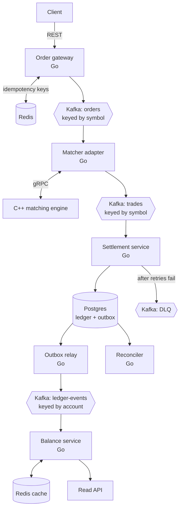
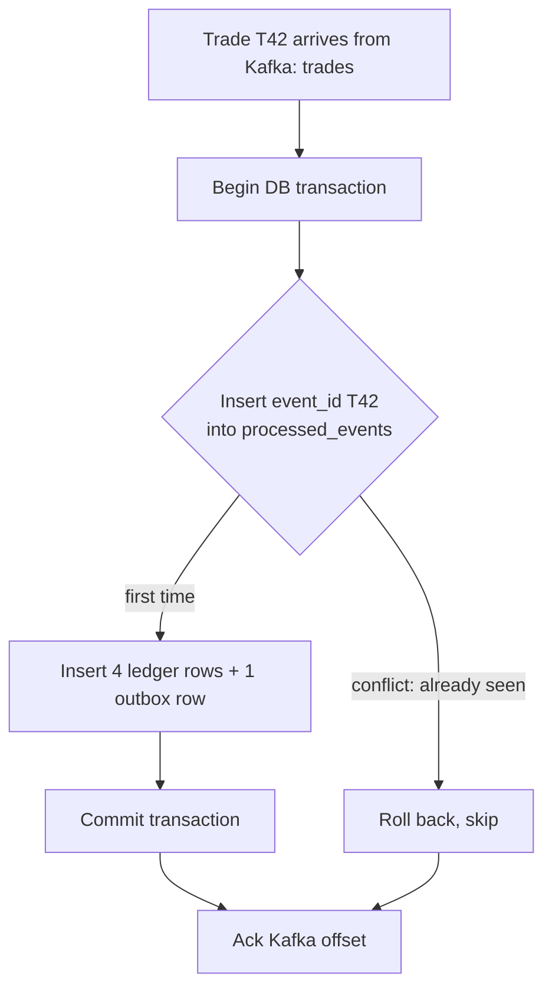

# Clearline: Project Spec

Event-driven trade settlement and ledger engine, built in Go with Kafka, Postgres, and Redis, with an existing C++ matching engine plugged in as the matcher.

Status: planning complete, Weekend 1 not started.

---

## 1. Why this project exists

Built to close specific resume gaps that came up repeatedly in backend, infrastructure, and fintech job postings, while showcasing existing strengths (distributed backend work at Gainsight, low-latency C++).

| Gap | Where it shows up in Clearline |
|---|---|
| Go | Gateway, matcher adapter, settlement, balance service, reconciler |
| Kafka and message queues | Every hop between services |
| Idempotency, retries, failure handling | Gateway idempotency keys, settlement dedupe, retries, dead-letter queue |
| Redis and caching | Idempotency keys, balance cache |
| gRPC | Go adapter calling the C++ matcher |
| Kubernetes | Local kind or k3d, then single-node k3s on the hosting VM, deployed with Helm |
| Observability (OpenTelemetry, Prometheus) | One trace per trade across all services, metrics, Grafana dashboards, alerts |
| Load and chaos testing | Benchmark report and scripted failure tests |
| Payments, ledgers, settlement | Double-entry ledger with continuous reconciliation |
| TypeScript (optional) | Small React dashboard showing live balances |
| AI agents (optional) | Phase 5 agent that diagnoses ledger questions using tools |

---

## 2. Requirements

### 2.1 Functional requirements (what the system does)

| ID | Requirement | Details |
|---|---|---|
| F1 | Accept orders | REST endpoint for buy and sell orders. Every request carries an idempotency key (a unique ID from the client) so a retried request never creates two orders. |
| F2 | Match orders | Existing C++ engine pairs buys and sells using price-time priority and emits trades. |
| F3 | Publish events | Orders and trades flow through Kafka topics, decoupling services and allowing replay. |
| F4 | Settle trades | Every trade becomes double-entry ledger rows in Postgres. Every debit has an equal credit. |
| F5 | Never post twice | If Kafka redelivers a trade, the ledger records it exactly once. |
| F6 | Serve balances | Read API returns live balances from a Redis cache rebuilt from ledger events. |
| F7 | Handle failures | Retries with backoff (increasing delay between retries), a dead-letter queue (DLQ) for messages that keep failing, and a replay tool. |
| F8 | Reconcile | Background job continuously proves the books balance: per asset, debits equal credits, and cached balances match the ledger. |

### 2.2 Non-functional requirements (how well it does it)

| Area | Target |
|---|---|
| Correctness | Zero double-postings, zero lost trades, ledger always balanced, verified under failure tests. Non-negotiable. |
| Throughput | Baseline 1,000 trades/s sustained without growing consumer lag. Stretch 5,000/s with batching. |
| Latency | See section 7. Always reported with hardware spec. |
| Fault tolerance | Survives settlement crash mid-stream, Kafka broker restart, duplicate messages. Reconciler confirms correctness afterward. |
| Observability | Traces across every hop, Prometheus metrics, Grafana dashboards, alerts on consumer lag and DLQ growth. |
| Testability | Unit tests, integration tests against real Kafka and Postgres in containers, load tests, chaos tests. |
| Deployability | One command locally (Docker Compose), Helm charts for Kubernetes, Terraform (or OpenTofu) for the server. |
| Security basics | No public write endpoints on the live demo. No secrets in the repo. |

### 2.3 Non-technical requirements

| Area | Requirement |
|---|---|
| Career goal | Every component maps to a resume gap (section 1). |
| Scope and time | About 4 weekends. Correctness before features. Cut the dashboard or cloud deploy before cutting tests. |
| Budget | $0. Local development plus Oracle Cloud Always Free for the live demo. |
| Documentation | README with architecture, short design-decision notes (example: "why an outbox instead of dual writes"), benchmark report with graphs. |
| Demo | Live read-only Grafana dashboard. 2-minute video of a chaos test showing the ledger survives. |
| Interview story | Every design choice has a tradeoff that can be explained out loud. |
| Honest claims | Every resume number traces to a reproducible benchmark with hardware stated. |

---

## 3. Architecture

### 3.1 Overview



Plain-text version:

```
 client ──REST──> [order-gateway: Go] ── idempotency keys ──> Redis
                    │
              Kafka: orders (key = symbol)
                    │
        [matcher-adapter: Go] ──gRPC──> [C++ matching engine]
                    │
              Kafka: trades (key = symbol)
                    │
        [settlement-service: Go] ──> Postgres (ledger + outbox + processed_events)
                    │                       │
              Kafka: DLQ              [outbox-relay: Go]
                                            │
                                  Kafka: ledger-events (key = account)
                                            │
                                  [balance-service: Go] <──> Redis ──> read API

 [reconciler: Go] audits Postgres continuously
 OpenTelemetry traces one trade across every hop, metrics to Prometheus, dashboards in Grafana
```

### 3.2 Components

| Component | Language | Responsibility |
|---|---|---|
| order-gateway | Go | REST API, validation, idempotency check in Redis, publish to `orders` |
| matcher-adapter | Go | Consume `orders`, call C++ engine over gRPC, publish fills to `trades` |
| matching engine | C++ | Existing engine (price-time priority, O(1) insert/cancel/lookup, ~5.2µs P50) |
| settlement-service | Go | Consume `trades`, write ledger rows + outbox row in one transaction, dedupe by `event_id` |
| outbox-relay | Go | Publish unsent outbox rows to `ledger-events`, mark them sent |
| balance-service | Go | Consume `ledger-events`, update Redis balances (deduped), serve read API |
| reconciler | Go | Periodically verify ledger invariants and cache consistency, emit metrics and alerts |

### 3.3 Kafka topics

| Topic | Key | Why this key |
|---|---|---|
| `orders` | symbol | Kafka only orders messages within a partition. Keying by symbol keeps every order for one symbol in sequence, which matching requires. |
| `trades` | symbol | Preserves per-symbol order downstream. |
| `ledger-events` | account | Each account's balance updates apply in order. |
| `trades.dlq` | original key | Holds messages that failed after all retries, for inspection and replay. |

### 3.4 Key design decisions

1. **Kafka between every stage, not direct calls.** If settlement is down, trades queue safely and settlement catches up from its last committed position on restart.
2. **C++ engine behind a thin Go adapter over gRPC.** Reuses the strongest existing work and practices cross-language service design. Tradeoff: one extra network hop (sub-millisecond locally).
3. **Transactional outbox.** Settlement never publishes to Kafka directly. It writes the event into an `outbox` table in the same database transaction as the ledger rows, and a relay publishes it afterward. This removes the failure where the database write succeeds but the publish fails, or the reverse.
4. **Ack after commit + dedupe = exactly-once effect.** Kafka delivers at least once. Consumers acknowledge a message only after their database commit, and skip any `event_id` already processed. Result: each trade takes effect exactly once.
5. **Never trade durability for speed.** Kafka `acks=all`, Postgres `synchronous_commit=on`. Latency is tuned with batching, not by weakening durability.

---

## 4. Settlement flow (per trade)



### 4.1 Dry run

Alice buys 10 AAPL at $150 from Bob. Matcher emits trade `T42`. Settlement writes:

| entry | trade | account | asset | amount |
|---|---|---|---|---|
| 1 | T42 | Alice | USD | -1,500 |
| 2 | T42 | Bob | USD | +1,500 |
| 3 | T42 | Bob | AAPL | -10 |
| 4 | T42 | Alice | AAPL | +10 |

USD nets to 0, AAPL nets to 0.

### 4.2 Invariants (checked by the reconciler and by tests)

1. For every asset, the sum of all ledger amounts is 0.
2. For every trade, its ledger rows net to 0 per asset.
3. Every account's cached balance in Redis equals the sum of its ledger rows.
4. Every `event_id` appears at most once in `processed_events`.
5. Every committed trade has exactly one outbox row.

---

## 5. Failure handling

| What breaks | What happens | Result |
|---|---|---|
| Settlement crashes before commit | Transaction rolls back, offset not acked, Kafka redelivers | Posted exactly once |
| Settlement crashes after commit, before ack | Redelivered, `event_id` already present, skip and ack | No double-post |
| Duplicate trade published upstream | Dedupe rejects the second copy | No double-post |
| Malformed message or unknown account | Retries with backoff, then DLQ plus alert | Pipeline keeps flowing, fix and replay |
| Kafka broker restart | Producers retry, consumers resume from last acked offset | Nothing lost |
| Outbox relay crashes mid-publish | Republishes, balance service dedupes on `event_id` | Balances stay exact |

Each row becomes a scripted chaos test. The reconciler verifies the outcome.

---

## 6. Data model (initial sketch, expect changes)

```sql
-- accounts
accounts(
  account_id   TEXT PRIMARY KEY,
  created_at   TIMESTAMPTZ NOT NULL DEFAULT now()
)

-- double-entry ledger, append-only
ledger_entries(
  entry_id     BIGSERIAL PRIMARY KEY,
  trade_id     TEXT NOT NULL,
  account_id   TEXT NOT NULL REFERENCES accounts(account_id),
  asset        TEXT NOT NULL,          -- 'USD', 'AAPL', ...
  amount       NUMERIC(20,8) NOT NULL, -- signed: negative = debit, positive = credit
  created_at   TIMESTAMPTZ NOT NULL DEFAULT now()
)
-- index: (account_id, asset), (trade_id)

-- dedupe table: one row per processed event
processed_events(
  event_id     TEXT PRIMARY KEY,
  processed_at TIMESTAMPTZ NOT NULL DEFAULT now()
)

-- transactional outbox
outbox(
  outbox_id    BIGSERIAL PRIMARY KEY,
  event_id     TEXT NOT NULL UNIQUE,
  topic        TEXT NOT NULL,
  key          TEXT NOT NULL,
  payload      JSONB NOT NULL,
  created_at   TIMESTAMPTZ NOT NULL DEFAULT now(),
  published_at TIMESTAMPTZ             -- NULL until relay publishes
)
```

Notes:
- Use `NUMERIC`, never floats, for money.
- Ledger is append-only. Corrections are new reversing entries, never updates or deletes.

---

## 7. Latency and throughput targets

Settlement is durability-bound, so targets are in milliseconds. The C++ matcher's microseconds are a small part of the total, and that contrast belongs in the report.

### 7.1 Targets (2-core Arm VM, 12 GB, single Kafka broker)

| Metric | Measures | Target |
|---|---|---|
| Order acknowledged | Client request until gateway confirms order is durably in Kafka | p50 < 5 ms, p99 < 15 ms |
| Order to ledger posted | Matched, settled, committed in Postgres | p50 < 20 ms, p99 < 75 ms |
| Balance freshness | Ledger commit until new balance visible in Redis | p99 < 50 ms |
| Throughput | Sustained without growing consumer lag | 1,000 trades/s baseline, 5,000/s stretch |

These are initial goals to be measured and adjusted, not guarantees.

### 7.2 Expected per-hop budget (rough, confirm by measurement)

```
gateway: validate + Redis idempotency check      ~0.5 ms
Kafka produce (orders), durable ack              ~2-5 ms
adapter consumes, gRPC call to C++ matcher       ~0.5-1 ms
  inside the engine: matching                    ~0.005 ms (5.2 µs)
Kafka produce (trades), durable ack              ~2-5 ms
settlement: DB transaction + commit              ~2-10 ms (disk flush dominates)
------------------------------------------------------------
order to ledger posted                           ~8-25 ms at p50
```

p99 will be several times higher due to Kafka batching, Postgres flush stalls, Go GC pauses, and cloud disk variance.

### 7.3 Tuning knobs

| Setting | Lower latency | Higher throughput |
|---|---|---|
| Kafka `linger.ms` (producer batching wait) | 0 ms | 5 to 10 ms |
| Trades per Postgres transaction | 1 | 50 to 100 (batched commit) |
| Kafka `acks` | `all` always | `all` always |
| Postgres `synchronous_commit` | `on` always | `on` always |

### 7.4 Reporting method

1. Measure an unbatched baseline first.
2. Change one setting at a time. Graph p50 and p99 against throughput for each change.
3. Find the knee: the throughput where p99 rises sharply. That is real capacity.
4. Always state hardware, broker count, and settings next to every number.

---

## 8. Testing strategy

| Layer | What | Tooling |
|---|---|---|
| Unit | Ledger row generation, invariant checks, idempotency logic | Go `testing` |
| Integration | Real Kafka, Postgres, Redis in containers | testcontainers-go or Docker Compose |
| Property-style | Random trade sequences always keep invariants | Go `testing` with generated inputs |
| Load | Throughput and latency curves | k6 or a custom Go load generator |
| Chaos | Every row in section 5 | Scripts that kill pods, restart brokers, inject duplicates |

Rule: write invariant tests (section 4.2) before writing the settlement logic.

---

## 9. Observability

- **Tracing:** OpenTelemetry. Propagate trace context in Kafka message headers so one trace follows a trade from gateway to ledger to balance.
- **Metrics (Prometheus):** request latency histograms per service, Kafka consumer lag per topic, DB commit latency, DLQ size, reconciler mismatches (must stay 0).
- **Dashboards (Grafana):** pipeline latency p50/p99, throughput, consumer lag, DLQ, reconciler status.
- **Alerts:** consumer lag growing, DLQ non-empty, any reconciler mismatch.

---

## 10. Deployment and hosting ($0)

### 10.1 Local
- Docker Compose runs Kafka (KRaft mode, no ZooKeeper), Postgres, Redis (or Valkey), Prometheus, Grafana.
- kind or k3d for practicing Kubernetes and Helm locally.

### 10.2 Live demo: Oracle Cloud Always Free
- Arm (Ampere A1) compute, 2 OCPUs and 12 GB RAM total (reduced from 4 OCPU / 24 GB in 2026). Enough for single-node k3s running the full stack.
- Caveats:
  - Arm machine: use arm64 images. Recompile the C++ engine for arm64.
  - Card required at signup for identity verification.
  - Accounts idle 30+ days can be treated as abandoned.
  - Stay strictly within free limits. If Ampere instances exceed the allowance without upgrading, all of them are disabled and later deleted.
  - "Out of host capacity" errors are common. Retry or try another availability domain.
- Provision the VM with Terraform (or OpenTofu) using the OCI provider.
- Expose only read-only Grafana and API docs publicly. Everything else behind the firewall.

### 10.3 Avoid
- Managed Kafka, managed Kubernetes (EKS etc.), Confluent Cloud. Costly for a personal project.

### 10.4 Licensing notes
- Redis is free for this use. Valkey is a drop-in fully open-source alternative.
- Terraform is free for personal use. OpenTofu is the open-source fork.

---

## 11. Build plan

| Phase | Scope | Done when |
|---|---|---|
| Weekend 1 | Settlement service + Postgres ledger + dedupe + invariant tests. No Kafka yet (feed trades from a test harness). | Invariant tests pass, duplicate trades never double-post |
| Weekend 2 | Kafka (orders, trades, ledger-events, DLQ), outbox relay, retries, matcher adapter + gRPC to C++ engine, gateway with Redis idempotency | One order flows end to end into the ledger |
| Weekend 3 | OpenTelemetry, Prometheus, Grafana, load tests, chaos tests, benchmark report | Report with latency/throughput graphs and chaos results |
| Weekend 4 | Helm charts, kind locally, Terraform + k3s on Oracle, optional TS React balance dashboard | Live read-only demo online |
| Optional 5 | Small AI agent that answers "why is this balance off?" by calling tools against ledger and reconciler | Agent with tool calls + a small eval set |

---

## 12. Proposed repo layout

```
clearline/
  CLAUDE.md
  README.md
  docs/
    SPEC.md               # this file
    decisions/            # short design-decision notes
    benchmarks/           # benchmark report, graphs
  proto/                  # gRPC definitions for the matcher
  services/
    gateway/
    matcher-adapter/
    settlement/
    outbox-relay/
    balance/
    reconciler/
  engine/                 # C++ matching engine + gRPC server wrapper
  migrations/             # SQL migrations
  deploy/
    compose/
    helm/
    terraform/
  loadtest/
  chaos/
```

---

## 13. Resume bullet template (fill with measured numbers only)

"Built an event-driven settlement engine in Go with Kafka and Postgres, sustaining X trades/s at p99 Y ms on a 2-core Arm VM; verified zero double-postings under duplicate delivery and pod failures using idempotent consumers and a transactional outbox."
