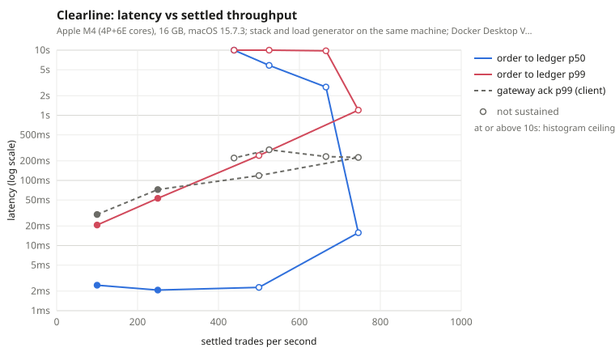

# Benchmarks

Every number here comes with its hardware, settings and the command that produced it (CLAUDE.md, SPEC 7.4).

## Baseline: 2026-11-19, Apple M4, unbatched



| | |
|---|---|
| Hardware | Apple M4 (4 performance + 6 efficiency cores), 16 GB, macOS 15.7.3 |
| Runtime | Docker Desktop 28.4.0, VM with 10 CPUs and 7.7 GiB. The whole stack (Postgres, Kafka, Valkey, C++ engine, 6 services, Prometheus) and the load generator all run on this one machine. |
| Durability (read from the running system) | Kafka `acks=all` (1 broker, replication 1); Postgres `synchronous_commit=on`, `fsync=on`; Valkey `appendfsync=always` |
| Code | measured at commit `6570761`, which became `3c3d99e` when rebased (the only difference is go.mod listing `client_model` as a direct dependency). One Postgres transaction per trade, one Valkey transaction per ledger event, gateway linger 0 |
| Load | Open loop, 30 s per rate. Crossing pairs (sell, then buy 1 unit at 100) on the `LOAD` book, so two orders make one trade. 100 accounts, at most 512 requests in flight. |
| Raw data | [results/2026-11-19-m4-baseline.json](results/2026-11-19-m4-baseline.json) |

| Orders/s offered | Trades/s settled | Ack p50 | Ack p99 | Order to ledger p50 | Order to ledger p99 | Freshness p50 | Freshness p99 | Settle tx p50 | Settlement lag at end | Balance lag at end | Sustained |
|---|---|---|---|---|---|---|---|---|---|---|---|
| 200 | 100 | 2.4 ms | 30.0 ms | 2.5 ms | 20.7 ms | 9.5 ms | 185 ms | 0.8 ms | 0 | 0 | **yes** |
| 500 | 250 | 1.9 ms | 72.5 ms | 2.1 ms | 53.2 ms | 106 ms | 1.53 s | 0.8 ms | 0 | 8 | **yes** |
| 1000 | 500 | 3.1 ms | 119 ms | 2.3 ms | 241 ms | >= 10 s | >= 10 s | 0.8 ms | 2 | 21,658 | no: balance behind |
| 1500 | 746 | 4.1 ms | 226 ms | 15.8 ms | 1.20 s | >= 10 s | >= 10 s | 0.9 ms | 437 | 41,392 | no: balance behind |
| 2000 | 666 | 6.5 ms | 233 ms | 2.71 s | 9.78 s | >= 10 s | >= 10 s | 1.2 ms | 8,319 | 37,348 | no: 666 of 1000/s |
| 3000 | 525 | 10.1 ms | 296 ms | 5.85 s | >= 10 s | >= 10 s | >= 10 s | 1.3 ms | 24,210 | 29,454 | no: 525 of 1500/s |
| 4000 | 438 | 14.4 ms | 221 ms | >= 10 s | >= 10 s | >= 10 s | >= 10 s | 1.8 ms | 40,285 | 24,466 | no: 438 of 2000/s |

How to read the columns:

- **Ack** is the client's view of `POST /orders`, from each request's scheduled time to its 202. Percentiles are exact, from every sample. The schedule is open loop, so queueing is charged to latency instead of being hidden.
- **Order to ledger** runs from the order's Kafka timestamp at the gateway to its trade committing in Postgres. **Freshness** runs from settlement's transaction to the balance being visible in Valkey. Both come from the services' own histograms and are accurate to within one bucket. `>= 10 s` means the top bucket.
- **Trades/s settled** is counted exactly from the ledger: distinct `LOAD-*` trades committed inside the window.
- **Sustained** means settled at least 95% of the target, with every consumer ending less than one second's worth of work behind (SPEC 2.2: no growing consumer lag).

## What it shows

1. **Sustained capacity end to end: 250 trades/s.** At that rate the whole pipeline keeps up. Order to ledger is 2.1 ms at p50 and 53 ms at p99, inside the SPEC 7.1 targets (20 ms and 75 ms). Balance freshness p99 is 1.5 s, against a 50 ms target, so it's already failing at this rate.
2. **The balance service is the first bottleneck.** At 500 trades/s settlement keeps up (2 trades behind), but the balance consumer falls 21,658 events behind in 30 s, handling about 280 of the 1000 events/s. Every event is a Valkey optimistic transaction (`WATCH`, read, `MULTI`/`EXEC`), applied one at a time, and with `appendfsync always` each `EXEC` waits for an fsync. A single apply takes 1.2 ms at p50 (`clearline_balance_apply_duration_seconds`, over the whole sweep), so one sequential consumer can't exceed about 850 events/s even before per-record overhead.
3. **Settlement tops out near 750 trades/s.** Its transaction takes 0.8 to 0.9 ms (p50), and trades settle one transaction at a time, in sequence. One record per commit caps it at roughly 1 / 0.9 ms, about 1100/s, before polling and offset commits.
4. **Throughput collapses past saturation instead of leveling off.** Offering 2000, 3000 and 4000 orders/s settles 666, 525 and 438 trades/s, and the settle transaction slows from 0.9 to 1.8 ms as offered load rises. *Hypothesis, not yet tested:* the gateway (4000 requests/s), the load generator and settlement all share the same 10 CPUs and one disk. So the more work the front of the pipeline does, the less is left for the back.
5. **The C++ engine is not a factor.** The gRPC submit round trip is 0.3 ms at p50 and 1.9 ms at p99 per call (`clearline_matcher_submit_duration_seconds`, over the whole sweep). The matching itself is the microseconds measured in LowLatencyBuffer.

## SPEC targets vs this baseline

| SPEC 7.1 target | Baseline | |
|---|---|---|
| Order acknowledged p50 < 5 ms, p99 < 15 ms | 1.9 to 2.4 ms / 30 to 72 ms at sustained rates | p50 met; p99 missed |
| Order to ledger p50 < 20 ms, p99 < 75 ms | 2.1 ms / 53 ms at 250 trades/s | met at 250/s |
| Balance freshness p99 < 50 ms | 185 ms at 100/s, 1.5 s at 250/s | missed |
| 1000 trades/s sustained | 250 trades/s | missed |

The next step is SPEC 7.3's tuning, changing one variable at a time with this sweep rerun after each:

1. Batch the balance service: apply all events in a fetch as a few pipelined Valkey transactions, grouped by account.
2. Batch settlement: many trades per Postgres transaction, still deduped and still acked only after the commit.
3. Run the load generator on separate hardware, to test hypothesis 4.

## Caveats

- **Docker Desktop on macOS.** Containers run in a Linux VM, and fsync goes through virtualized storage, so commit costs here differ from bare metal and from the Oracle Arm VM target (SPEC 7.1). These numbers compare designs on this machine. They aren't claims about production hardware.
- **Single broker.** Kafka has 1 broker with replication factor 1 ([decision 0001](../decisions/0001-single-broker-durability.md)).
- **Shared CPUs.** The load generator shares the machine with the system under test.
- **Same clock.** Latencies that cross services compare timestamps from one host's clock.

## Reproduce

```sh
make up-all
make bench HARDWARE="your CPU, memory, Docker resources"        # rates 200..3000 orders/s, 30 s each
# or exactly this sweep:
go run ./cmd/loadgen -rates 200,500,1000,1500,2000,3000,4000 -duration 30s \
  -hardware "..." -json docs/benchmarks/results/<name>.json -svg docs/benchmarks/<name>.svg
# re-judge and redraw a saved run without sending load:
go run ./cmd/loadgen -replot docs/benchmarks/results/<name>.json -svg docs/benchmarks/<name>.svg
```
