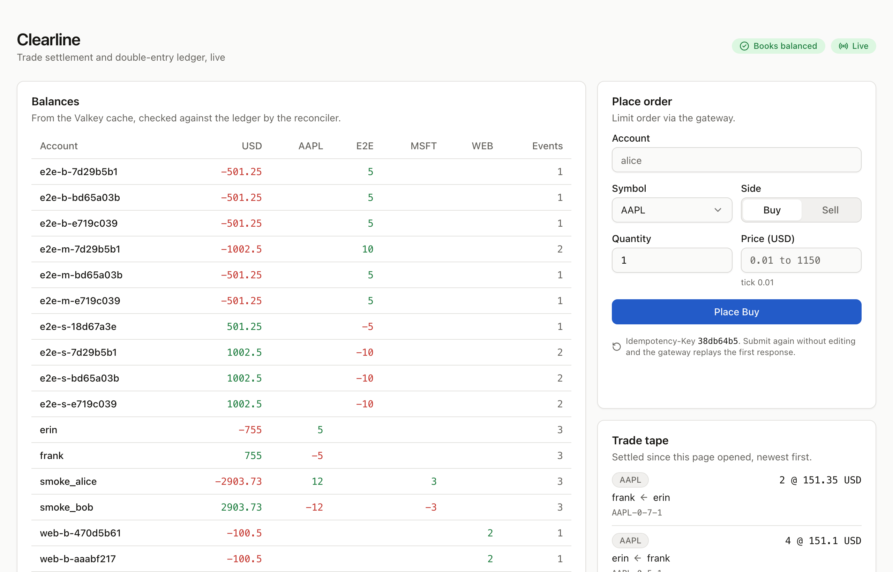

# web: Clearline dashboard

React + TypeScript dashboard for the running stack. It shows:

- live balances per account
- a trade tape fed by Server-Sent Events
- the reconciler's verdict
- an order form, shown only where the gateway is routed



## Run

```sh
make up-all     # whole stack, dashboard on http://localhost:3000 (nginx image)
make web-dev    # or: Vite dev server on :5173 with hot reload, proxying to the same services
```

Node 24 (`.nvmrc`). Install once with `make web-install`.

## Checks

| Command | What |
|---|---|
| `npm run typecheck` | `tsc` in strict mode with `noUncheckedIndexedAccess` and `exactOptionalPropertyTypes` |
| `npm run lint` | ESLint with typescript-eslint `strictTypeChecked` and the React hooks rules |
| `npm run format:check` | Prettier, with Tailwind class ordering |
| `npm test` | Vitest + Testing Library (jsdom): decimal math, trade tape, components |
| `npm run e2e` | Playwright against the compose stack, through the real nginx image |

`make web-check` runs all of them except e2e; CI runs every one.

## Layout

```
src/
  components/ui/   reusable primitives (Button, Card, Badge, Table, Input, Label, Select, Segmented, Field)
  components/      feature components built only from ui/ (BalancesTable, TradeTape, OrderForm, StatusBadge)
  lib/api.ts       typed API client; every response is validated at runtime
  lib/decimal.ts   exact money: decimal strings to BigInt fixed point, never JS floats
  lib/trades.ts    builds the trade tape from per-account ledger events
  lib/useLedgerStream.ts  EventSource hook with reconnect handling
  index.css        design tokens (light + dark); components use only semantic names
e2e/               Playwright tests
nginx.conf.template  serves the build, proxies /api/* (one origin, so no CORS), security headers
```

## Design notes

- **One origin.** The browser only calls `/api/gateway`, `/api/balance` and `/api/reconciler` on its own origin. nginx in production, and Vite in development, forward these to the services, so no service needs CORS.
- **The stream is a signal, not the source.** Each ledger event refetches balances from the API. A dropped or slow stream costs a refresh, never a wrong number.
- **Money stays exact.** Amounts stay decimal strings on the wire and become BigInt fixed point (8 places, the ledger's `NUMERIC(20,8)`) in the browser.
- **The order form demonstrates idempotency.** The Idempotency-Key belongs to the form's contents. Resubmit without editing and the gateway replays the first response; edit any field and a new key starts.
- **Read-only demo.** The public deploy leaves out the `/api/gateway` route, `/symbols` stops answering, and the form disappears.
- **Components follow the shadcn/ui pattern:**
  - Radix primitives for accessible behavior (keyboard, focus, ARIA)
  - Tailwind CSS v4 classes on top
  - `cva` variants for each component's options
